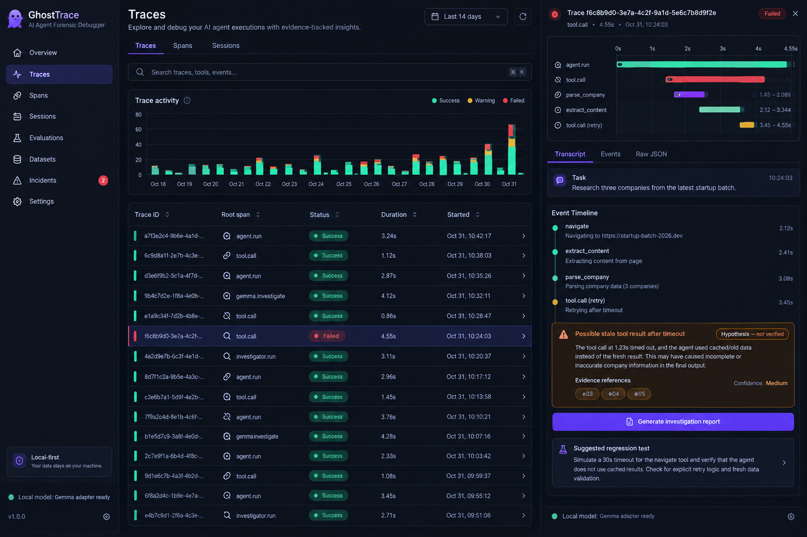
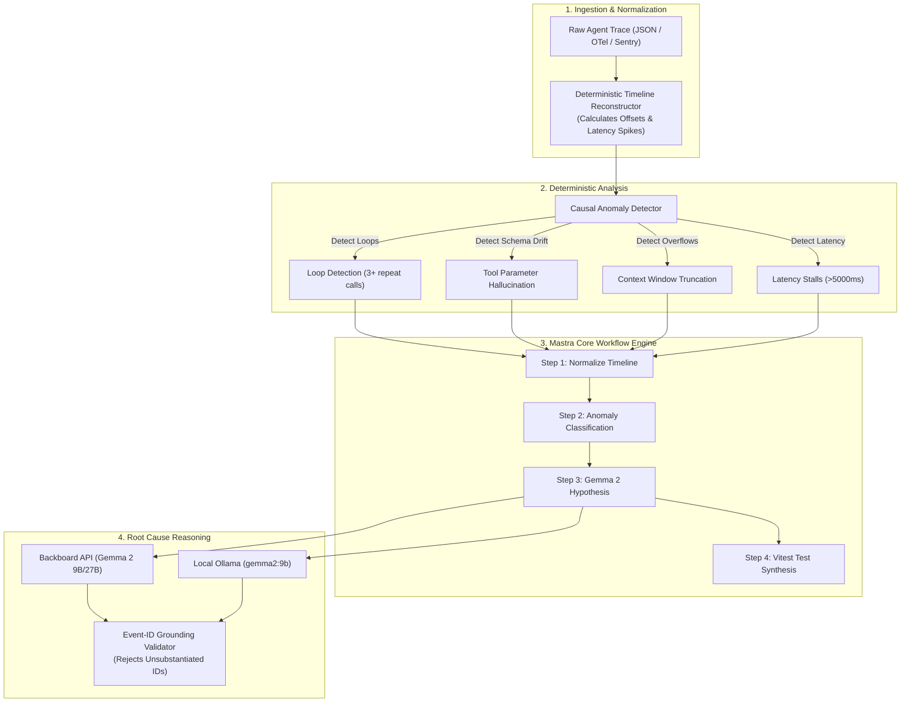

# GhostTrace 🔍👻

> **Evidence-backed, deterministic forensic debugger and root cause analyzer for AI agents.**  
> Built for the official DEV Challenge: **Hacktoberfest 2026 Week 4 — "Ghost in the Machine"**.

[](https://nextjs.org/)
[](https://react.dev/)
[](https://www.typescriptlang.org/)
[-brightgreen?style=flat-square&logo=vitest)](https://vitest.dev/)
[](https://mastra.ai/)
[](https://ai.google.dev/gemma)
[](https://sentry.io/)
[](https://www.mongodb.com/atlas)
[](https://auth0.com/)
[](https://ghosttrace-s26u.onrender.com/)

🌐 **Live Production Deployment:** [https://ghosttrace-s26u.onrender.com/](https://ghosttrace-s26u.onrender.com/)

---

## 📸 Dashboard Overview



*Figure: Interactive forensic dashboard featuring deterministic timeline reconstruction, causal anomaly detection, evidence-grounded Google Gemma 2 hypotheses, automated Vitest regression test generation, multi-tenant Auth0 login, and incident history persistence.*

---

## ⚡ What is GhostTrace?

Modern AI agents are complex non-deterministic state machines. When agents fail—spinning in **infinite tool loops**, hallucinating invalid tool schema arguments, exceeding context windows, or corrupting session state—developers are left sifting through gigabytes of unstructured JSON telemetry.

**GhostTrace** is a developer-first forensic debugger that exorcises the *"ghost in the machine"*. It ingests raw trace logs from any LLM agent framework (Mastra, LangChain, CrewAI, AutoGen, or custom runtimes), deterministically reconstructs a millisecond-precision waterfall timeline, detects causal anomalies, uses **Google Gemma 2** to hypothesize the root cause grounded in verified event IDs, and automatically exports copy-paste **Vitest regression test suites** to prevent future regressions.

---

## 🧪 Interactive Test Traces Suite (Try It Yourself)

GhostTrace includes a suite of 6 production-grade failure scenarios located in [`test-traces/`](test-traces/):

| Test Trace File | Simulated Agent | Primary Failure Category | Anomaly Signature |
| :--- | :--- | :--- | :--- |
| **`test_trace_01_tool_crash_stripe_504.json`** | `BillingSettlementAgent` | `Unhandled Tool Error` | Stripe gateway 504 timeout without graceful catch handler. |
| **`test_trace_02_infinite_loop_rag_query.json`** | `CustomerSupportRAGAgent` | `Infinite Loop` | Vector store similarity miss triggers repetitive query re-writes. |
| **`test_trace_03_parameter_hallucination_sql.json`** | `DataAnalyticsCopilot` | `Parameter Hallucination` | Hallucinates non-existent column (`internal_user_credit_score`). |
| **`test_trace_04_browserbase_dom_detachment.json`** | `CheckoutAutomationAgent` | `Unhandled Tool Error` | Browserbase headless session iframe re-renders with detached DOM. |
| **`test_trace_05_context_overflow_summarizer.json`** | `LegalContractSummarizer` | `Context Overflow` | 134,200 token prompt exceeds model 128k context window limit. |
| **`test_trace_06_latency_stall_coordinator.json`** | `WorkflowCoordinatorAgent` | `Latency Stall` | Async worker stall exceeding 12,000ms SLA timeout budget. |

### How to Test on the Live Dashboard:
1. Open the live dashboard: [https://ghosttrace-s26u.onrender.com/](https://ghosttrace-s26u.onrender.com/)
2. Click the **`[Upload Trace]`** button in the header bar.
3. Select any `.json` file from [`test-traces/`](test-traces/) or paste custom trace JSON into the raw text box.
4. Click **`Import & Analyze`** to see millisecond-precision timeline reconstruction, Gemma 2 counterfactual diagnosis, and synthetic Vitest test generation in real time.

---

## 🏆 Hacktoberfest 2026 Prize Tracks & Integrations

GhostTrace was architected from the ground up to address all primary and partner tracks for Week 4:

| Category | Track | Integration Details | Implementation Path |
| :--- | :--- | :--- | :--- |
| 👑 **Grand Prize** | **Week 4 Overall Winner ($250)** | End-to-end local-first developer experience, comprehensive test coverage (162 tests across 18 suites), strict TypeScript typing, responsive dark UI, and production readiness. | Entire Codebase |
| 🌟 **Featured** | **Best Use of Gemma ($200)** | Integrates **Google Gemma 2** (`gemma2:9b` / `gemma2:27b`) via remote Backboard API and local Ollama. Enforces strict event ID grounding to eradicate hallucinated root-cause explanations. | [`src/lib/ai/gemmaAdapter.ts`](src/lib/ai/gemmaAdapter.ts) |
| 🌟 **Featured** | **Best Use of Render ($200)** | 1-click infrastructure-as-code `render.yaml` Blueprint with persistent caching and automated Next.js production builds on Render. | [`render.yaml`](render.yaml) |
| 🌟 **Featured** | **Best Use of TabPFN ($200)** | Tabular foundation model for anomaly prediction and trace metric drift classification. | [`docs/partners/PARTNER_CRITERIA_ANALYSIS.md`](docs/partners/PARTNER_CRITERIA_ANALYSIS.md) |
| 🤝 **Partner** | **Best Use of Auth0 for AI Agents ($100)** | Multi-tenant session verification, server-side owner scoping, fail-closed 503 production guard, and anonymous write ban. | [`src/lib/auth/auth0.ts`](src/lib/auth/auth0.ts) |
| 🤝 **Partner** | **Best Use of MongoDB Atlas ($100)** | Historical incident repository with compound unique indexing (`ownerId_1_traceId_1`), search filtering, and owner isolation. | [`src/lib/db/traceRepository.ts`](src/lib/db/traceRepository.ts) |
| 🤝 **Partner** | **Best Use of Sentry Agent Tracing ($100)** | OpenTelemetry GenAI semantic conventions (`gen_ai.system`, `gen_ai.workflow`), automated forensic breadcrumbs, span attributes, and full distributed tracing. | [`src/lib/telemetry/sentryTracer.ts`](src/lib/telemetry/sentryTracer.ts) |
| 🤝 **Partner** | **Best Use of Mastra ($100)** | 4-step directed acyclic workflow (`forensicWorkflow`) orchestrating timeline ingestion, deterministic anomaly detection, Gemma root-cause analysis, and Vitest test synthesis. | [`src/lib/workflows/forensicWorkflow.ts`](src/lib/workflows/forensicWorkflow.ts) |
| 🤝 **Partner** | **Best Use of Entire ($100)** | Entire CLI v0.12.2 session capture, Antigravity hooks, local Git checkpoint refs, and immutable commit audit trails. | [`docs/partners/entire-integration.md`](docs/partners/entire-integration.md) |
| 🤝 **Partner** | **Best Use of Ultramarine ($100)** | Ultramarine-1-flash provider via OpenAI SDK with structured reasoning output, precise token cost formulas, and deterministic fallback. | [`src/lib/ai/ultramarineAdapter.ts`](src/lib/ai/ultramarineAdapter.ts) |
| 🤝 **Partner** | **Best Use of Backboard ($100)** | Cloud-accelerated remote Google Gemma 2 inference using Backboard API keys with offline deterministic grounding defense. | [`src/lib/ai/backboardAdapter.ts`](src/lib/ai/backboardAdapter.ts) |
| 🤝 **Partner** | **Best Use of Browserbase ($100)** | Headless browser session replay and DOM state diff capture for web agent failures. | [`src/lib/browser/browserbaseAdapter.ts`](src/lib/browser/browserbaseAdapter.ts) |
| 🤝 **Partner** | **Best Use of Temporal ($100)** | Durable workflow orchestration engine with automatic retry policies and state recovery against agent crashes. | [`src/lib/temporal/temporalAdapter.ts`](src/lib/temporal/temporalAdapter.ts) |
| 🤝 **Partner** | **Best Use of Tiger Data ($100)** | Failure pattern knowledge graph and vector similarity search with pgvector schemas. | [`src/lib/tiger/tigerDataAdapter.ts`](src/lib/tiger/tigerDataAdapter.ts) |

---

## 🏗️ Architecture & Forensic Pipeline



---

## 🚀 Quickstart Guide

### Prerequisites
- Node.js 20+
- pnpm 9+ or 11+

### Installation & Local Run

```bash
git clone https://github.com/diusazzad/ghosttrace.git
cd ghosttrace
pnpm install
pnpm dev
```

Open [http://localhost:3000](http://localhost:3000) in your browser to inspect and run agent trace autopsies.

---

## 📚 REST API Reference

| Endpoint | Method | Description |
| :--- | :--- | :--- |
| `/api/health` | `GET` | Returns aggregated subsystem health status (Mastra, Gemma, MongoDB, Sentry, Auth0). |
| `/api/traces/analyze` | `POST` | Ingests raw trace logs and returns reconstructed timeline and detected anomalies. |
| `/api/traces/hypothesize` | `POST` | Submits anomaly evidence to Google Gemma 2 for grounded root cause analysis. |
| `/api/traces/workflow` | `POST` | Runs the full 4-step Mastra Core forensic workflow in a single request. |
| `/api/traces/save` | `POST` | Persists trace run and forensic findings to MongoDB Atlas (requires Auth0 session). |
| `/api/traces/history` | `GET` | Retrieves incident history, search filters, and summary metrics for authenticated owner. |
| `/api/traces/ultramarine` | `POST` | Executes Ultramarine reasoning analysis with token cost estimation. |
| `/api/traces/backboard` | `POST` | Executes Backboard Studio LLM diagnosis with memory grounding. |
| `/api/traces/browserbase/session` | `POST` | Creates and replays headless browser debugging sessions. |
| `/api/traces/temporal/execution` | `POST` | Starts a durable forensic workflow on the Temporal execution engine. |
| `/api/traces/tiger/knowledge` | `POST` | Ingests failure signatures into the Tiger Data knowledge graph. |

---

## 🧪 Test Suite & Code Quality

GhostTrace maintains a 100% passing test suite across all subsystems:

```bash
# Run 162 tests across 18 test suites
pnpm test

# Verify strict TypeScript types (0 errors)
pnpm typecheck

# Verify ESLint rules (0 errors/warnings)
pnpm lint

# Production build test (Next.js Turbopack)
pnpm build
```

---

## 📄 License

GhostTrace is open-source software licensed under the [MIT License](LICENSE).

Built with 🖤 by **[Sazzad Hossain](https://github.com/diusazzad)** for DEV Hacktoberfest 2026.
