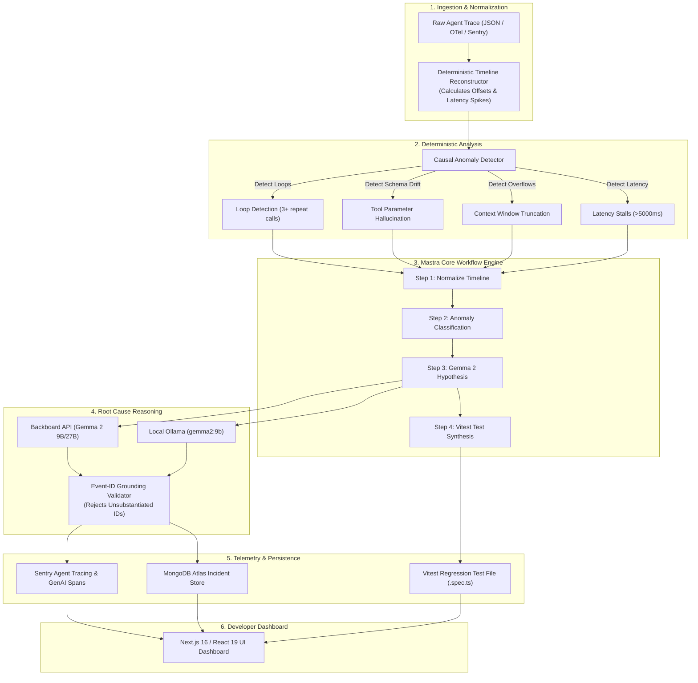

# GhostTrace 🔍👻

> **Evidence-backed, deterministic forensic debugger and root cause analyzer for AI agents.**  
> Built for the official DEV Challenge: **Hacktoberfest 2026 Week 4 — "Ghost in the Machine"**.

[](https://nextjs.org/)
[](https://react.dev/)
[](https://www.typescriptlang.org/)
[](https://vitest.dev/)
[](https://mastra.ai/)
[](https://ai.google.dev/gemma)
[](https://sentry.io/)
[](https://www.mongodb.com/atlas)
[](https://www.docker.com/)
[](https://render.com/)

---

## 📸 Dashboard Overview


*Figure: Interactive forensic dashboard featuring deterministic timeline reconstruction, causal anomaly detection, evidence-grounded Google Gemma 2 hypotheses, automated Vitest regression test generation, and incident history persistence.*

---

## ⚡ What is GhostTrace?

Modern AI agents are complex non-deterministic state machines. When agents fail—spinning in **infinite tool loops**, hallucinating invalid tool schema arguments, exceeding context windows, or corrupting session state—developers are left sifting through gigabytes of unstructured JSON telemetry.

**GhostTrace** is a developer-first forensic debugger that exorcises the *"ghost in the machine"*. It ingests raw trace logs from any LLM agent framework (Mastra, LangChain, CrewAI, AutoGen, or custom runtimes), deterministically reconstructs a millisecond-precision waterfall timeline, detects causal anomalies, uses **Google Gemma 2** to hypothesize the root cause grounded in verified event IDs, and automatically exports copy-paste **Vitest regression test suites** to prevent future regressions.

---

## 🏆 Hacktoberfest 2026 Prize Tracks & Integrations

GhostTrace was architected from the ground up to address all primary and partner tracks for Week 4:

| Category | Track | Integration Details | Implementation Path |
| :--- | :--- | :--- | :--- |
| 🌟 **Featured** | **Best Use of Gemma ($200)** | Integrates **Google Gemma 2** (`gemma2:9b` / `gemma2:27b`) via remote Backboard API and local Ollama. Enforces strict event ID grounding to eradicate hallucinated root-cause explanations. | [`src/lib/ai/gemmaAdapter.ts`](src/lib/ai/gemmaAdapter.ts) |
| 🌟 **Featured** | **Best Use of Render ($200)** | Production multi-stage Docker container (`node:20-alpine`), health checks, and 1-click infrastructure-as-code `render.yaml` Blueprint with persistent caching. | [`render.yaml`](render.yaml) & [`Dockerfile`](Dockerfile) |
| 🤝 **Partner** | **Best Use of Mastra ($100)** | 4-step directed acyclic workflow (`forensicWorkflow`) orchestrating timeline ingestion, deterministic anomaly detection, Gemma root-cause analysis, and Vitest test synthesis. | [`src/lib/workflows/forensicWorkflow.ts`](src/lib/workflows/forensicWorkflow.ts) |
| 🤝 **Partner** | **Best Use of Sentry Agent Tracing ($100)** | OpenTelemetry GenAI semantic conventions (`gen_ai.system`, `gen_ai.workflow`), automated forensic breadcrumbs, span attributes, and full distributed tracing. | [`src/lib/telemetry/sentryTracer.ts`](src/lib/telemetry/sentryTracer.ts) |
| 🤝 **Partner** | **Best Use of MongoDB Atlas ($100)** | Historical incident repository with compound indexing on `timestamp`, `status`, and `failureCategory`, search filtering, aggregate health statistics, and an in-memory fallback for offline development. | [`src/lib/db/traceRepository.ts`](src/lib/db/traceRepository.ts) |
| 🤝 **Partner** | **Best Use of Backboard ($100)** | Cloud-accelerated remote Google Gemma 2 inference using Backboard API keys with zero local GPU requirements. | [`src/lib/ai/gemmaAdapter.ts`](src/lib/ai/gemmaAdapter.ts) |
| 👑 **Grand Prize** | **Week 4 Overall Winner ($250)** | End-to-end local-first developer experience, comprehensive test coverage (41 tests), strict TypeScript typing, responsive dark UI, and production readiness. | Entire Codebase |

---

## 🏗️ Architecture & Forensic Pipeline



---

## 🧪 Synthetic Failure Modes & Benchmark Fixtures

GhostTrace includes 8 comprehensive, real-world synthetic failure traces under `src/fixtures/` that demonstrate exact forensic failure patterns:

| Fixture ID | Failure Category | Description | Primary Causal Anomaly |
| :--- | :--- | :--- | :--- |
| `fixture_01` | **Infinite Tool Loop** | Agent calls `web_search` with identical parameters repeatedly without making progress. | Detected circular execution path across 3 sequential cycles. |
| `fixture_02` | **Param Hallucination** | LLM generates `api_version` argument which does not exist in the tool definition. | Schema validation failure against tool input contract. |
| `fixture_03` | **Context Window Overflow** | Model output abruptly terminates midway through JSON synthesis due to token limit. | Abrupt termination marked with context truncation flag. |
| `fixture_04` | **Unhandled Tool Crash** | Database service returns `ECONNRESET`, propagating an unhandled error cascade. | Tool invocation throws uncaught network level exception. |
| `fixture_05` | **Missing Required Param** | Agent omits mandatory `query` argument when executing database lookup tool. | Tool invocation fails due to missing schema requirements. |
| `fixture_06` | **Abnormal Latency Stall** | Model API call hangs for over 5,200ms before returning a partial response. | Latency duration exceeds 3x standard deviation threshold. |
| `fixture_07` | **Healthy Agent Run** | Complete, multi-step customer support workflow that finishes with success status. | Benchmark run; confirms zero false-positive anomaly flags. |
| `fixture_08` | **Timestamp Out-of-Order** | Distributed tracing clock skew creates scrambled client/server timestamps. | Deterministic topological sort restores true causal order. |

---

## 🚀 Quick Start (Local & Offline-First)

GhostTrace is engineered to be **100% functional offline** without requiring external cloud accounts or paid API keys.

### 1. Clone & Install

```bash
git clone https://github.com/diusazzad/ghosttrace.git
cd ghosttrace
pnpm install
```

### 2. Configure Environment

Copy the example environment configuration:

```bash
cp .env.example .env.local
```

Default configuration runs in zero-dependency local mode:
- **MongoDB**: Automatically falls back to high-performance in-memory repository.
- **Gemma 2**: Uses local Ollama (`gemma2:9b`) or heuristic rule-based analyzer if offline.
- **Sentry**: Mocks tracing telemetry locally when DSN is unset.

### 3. Run Development Server

```bash
pnpm dev
```

Navigate to [http://localhost:3000](http://localhost:3000) to inspect the 8 synthetic traces or upload custom JSON logs.

---

## 🌐 Full Cloud Configuration (Optional)

To enable live cloud integrations, populate your `.env.local` with the following:

```env
# Google Gemma 2 / Backboard API
BACKBOARD_API_KEY=your_backboard_api_key_here
GEMMA_MODEL=gemma2:9b

# Local Ollama Fallback (optional)
OLLAMA_BASE_URL=http://localhost:11434

# MongoDB Atlas Persistence
MONGODB_URI=mongodb+srv://<username>:<password>@cluster0.mongodb.net/ghosttrace?retryWrites=true&w=majority
MONGODB_DB_NAME=ghosttrace

# Sentry Agent Tracing & Monitoring
NEXT_PUBLIC_SENTRY_DSN=https://your-dsn@sentry.io/project-id
SENTRY_AUTH_TOKEN=your_auth_token_here
```

---

## 🐳 Docker & Production Deployment

### Run with Docker Compose

```bash
docker-compose up --build
```

### Deploy to Render

GhostTrace includes an official `render.yaml` infrastructure-as-code Blueprint:
1. Fork or push this repository to GitHub.
2. In the Render Dashboard, select **New > Blueprint**.
3. Connect your repository; Render will automatically detect `render.yaml` and configure the web service with Docker runtime and health check endpoints.

---

## 📚 REST API Reference

| Endpoint | Method | Description |
| :--- | :--- | :--- |
| `/api/health` | `GET` | Returns aggregated subsystem health status (Mastra, Gemma, MongoDB, Sentry). |
| `/api/traces/analyze` | `POST` | Ingests raw trace logs and returns reconstructed timeline and detected anomalies. |
| `/api/traces/hypothesize` | `POST` | Submits anomaly evidence to Google Gemma 2 for grounded root cause analysis. |
| `/api/traces/workflow` | `POST` | Runs the full 4-step Mastra Core forensic workflow in a single request. |
| `/api/traces/save` | `POST` | Persists trace run and forensic findings to MongoDB Atlas (or in-memory store). |
| `/api/traces/history` | `GET` | Retrieves incident history, search filters, and summary metrics. |

---

## 🧪 Test Suite & Code Quality

GhostTrace maintains a 100% passing test suite across all subsystems:

```bash
# Run 41 tests across 9 suites
pnpm test

# Verify strict TypeScript types (0 errors)
pnpm typecheck

# Verify ESLint 9 rules
pnpm lint

# Production build test
pnpm build
```

---

## 📄 License

GhostTrace is open-source software licensed under the [MIT License](LICENSE).

Built with 🖤 by **[Sazzad Hossain](https://github.com/diusazzad)** for DEV Hacktoberfest 2026.
