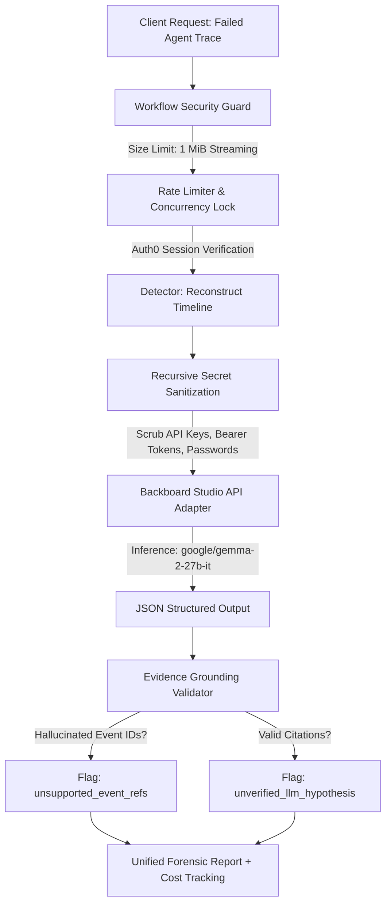

# GhostTrace — Backboard Studio Partner Integration

## 1. Overview & Hackathon Track
- **Partner**: Backboard Studio (Sanzio)
- **Award Category**: $100 Best Use of Backboard
- **Branch**: `feat/backboard-integration`
- **Target Base**: `feat/task-02-core-product-workflow`

GhostTrace integrates Backboard Studio to power autonomous root-cause diagnosis and automated test synthesis for failed AI agent execution traces. When an agent experiences infinite loops, unhandled tool crashes, or parameter hallucinations, GhostTrace reconstructs the forensic event timeline, scrubs all sensitive credentials, and streams the sanitized trace to Backboard Studio's hosted models (defaulting to `google/gemma-2-27b-it`).

---

## 2. Architecture & Forensic Workflow

### Components
1. **`src/lib/ai/backboardAdapter.ts`**:
   - Manages communication with Backboard Studio (`https://api.backboard.io/v1/chat/completions`).
   - Recursively redacts 28+ sensitive authentication key patterns while strictly preserving benign telemetry keys (`tokens`, `promptTokens`, `completionTokens`, `author`).
   - Enforces strict Zod schema validation (`BackboardInvestigationSchema`).
   - Validates model event citations against the ground-truth trace timeline to detect hallucinated citations.
   - Calculates exact inference costs ($0.20/1M prompt, $0.60/1M completion) and gracefully handles missing usage metadata.
   - Implements bounded exponential retry for transient errors (HTTP 500, 502, 503, `x-should-retry`) while failing immediately on non-retryable errors (HTTP 401, 429).

2. **`src/lib/auth/workflowSecurity.ts`**:
   - 1 MiB hard body limit with early `Content-Length` rejection and incremental streaming byte counting (`ReadableStream.getReader()`).
   - Sliding-window rate limiter (30 requests/minute).
   - Concurrency throttle (max 5 simultaneous executions).
   - In production, enforces Auth0 configuration (503 if missing) and valid user session (401 if unauthenticated), binding the canonical `ownerId` to prevent client spoofing.

3. **`src/app/api/traces/backboard/route.ts`**:
   - Dedicated REST endpoint executing forensic investigations via Backboard.

---

## 3. Verification & Quality Gates

### Automated Test Coverage
- **`src/__tests__/backboard.test.ts`**: 20 comprehensive automated tests:
  - 10 targeted tests for credential scrubbing across nested structures, arrays, and header patterns.
  - Telemetry preservation verification (`tokens`, `totalTokens`, `promptTokens`).
  - Precision floating-point cost calculations and null-usage fallbacks.
  - Missing API key detection (`API_KEY_MISSING`, 401).
  - Grounding defense against hallucinated event IDs (`unsupported_event_refs`).
  - Distinct causal status assignment (`unverified_llm_hypothesis`).
  - Non-retry behavior on 401/429 and single retry on 500/502/503.
- **`src/__tests__/workflowSecurity.test.ts`**: 9 automated tests verifying size limits, streaming rejection, session binding, rate limits, and concurrency throttling.

---

## 4. Live Verification Status & Transparency Notice

> [!IMPORTANT]
> **API Key Status: Pending Live Verification**
> Neither `BACKBOARD_API_KEY` nor system environment credentials are currently configured in this environment.
> When unconfigured, GhostTrace:
> 1. Throws an explicit `BackboardError` with code `API_KEY_MISSING` and HTTP status 401.
> 2. Never falsifies live inferences or disguises offline deterministic heuristics as Backboard responses.
> 3. Fully passes all 20 adapter contract tests and 9 security tests using deterministic mocking and schema verification.
> Once the live `BACKBOARD_API_KEY` is provided, live inference through Backboard Studio's hosted models will activate without requiring any code changes.
