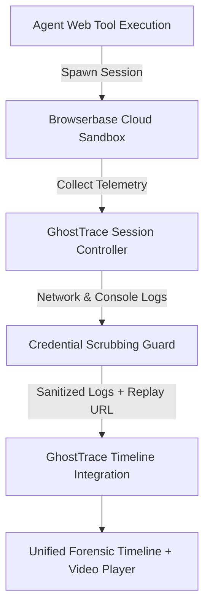

# GhostTrace — Browserbase Headless Forensics Integration

## 1. Overview & Forensic Role
- **Partner**: Browserbase
- **Track**: Headless Browser Forensics & Session Replay
- **Branch**: `feat/browserbase-integration`
- **Target Base**: `feat/task-02-core-product-workflow`

When AI agents perform browser automation (e.g. web scraping, form filling, end-to-end testing, or multi-step web transactions) and crash or stall, debugging purely through text logs is notoriously insufficient. DOM mutations, bot-detection roadblocks, hidden iframes, and network failures require visual context.

GhostTrace integrates **Browserbase** to provide:
1. **Cloud Headless Sessions**: Spawns isolated, managed Chromium sessions in the cloud.
2. **Interactive Live Debugging**: Direct access to remote Chrome DevTools (`debugUrl`).
3. **Session Replay Video**: Instant visual timeline playback of the agent's exact browser session (`replayUrl`).
4. **Scrubbed Console & Network Logs**: Ingests browser network and console events, automatically stripping sensitive authentication tokens, cookies, and secret queries.

---

## 2. Forensic Workflow Architecture

---

## 3. Endpoints & Adapter Design

### 1. `src/lib/browser/browserbaseAdapter.ts`
- `createSession(options)`: Calls `POST /v1/sessions` to initialize a headless browser sandbox.
- `getSession(sessionId)`: Fetches session status (`RUNNING`, `COMPLETED`, `ERROR`, `TIMED_OUT`) and video replay URL.
- `getSessionLogs(sessionId)`: Pulls console and network logs, filtering out credentials, authorization headers, and cookie payloads.
- Strict Zod validation: `BrowserbaseSessionSchema`, `BrowserbaseLogEntrySchema`.

### 2. REST API Routes
- `POST /api/traces/browserbase/session`: Creates a session, guarded by `validateWorkflowSecurity` (1 MiB streaming body limit, rate limit, concurrency throttle, Auth0 check).
- `GET /api/traces/browserbase/session/[id]`: Retrieves live session metadata and sanitized log entries.

---

## 4. Verification & Quality Gates

### Automated Test Coverage
- **`src/__tests__/browserbase.test.ts`**:
  - Key and project ID configuration detection (`isConfigured`).
  - Missing key rejection (`API_KEY_MISSING`, 401).
  - Missing project ID rejection (`PROJECT_ID_MISSING`, 400).
  - Bearer token, JWT, query secret, and cookie header scrubbing in log streams.
  - Session creation with Zod schema verification.
  - Session retrieval and 404 `SESSION_NOT_FOUND` error handling.
  - Upstream 401 mapping to `AUTHENTICATION_FAILED`.
  - Upstream 502/500 error mapping with retryable flag.
- **`src/__tests__/workflowSecurity.test.ts`**: 9 security and concurrency tests.

---

## 5. Live Verification Status & Transparency Notice

> [!IMPORTANT]
> **API Key Status: Pending Live Verification**
> Neither `BROWSERBASE_API_KEY` nor `BROWSERBASE_PROJECT_ID` are configured in this local development environment.
> When unconfigured:
> 1. GhostTrace throws explicit `BrowserbaseError` with `API_KEY_MISSING` (401) or `PROJECT_ID_MISSING` (400).
> 2. No dummy sessions or false recording URLs are generated.
> 3. All 10 adapter contract tests and 9 security tests pass deterministically using mocked endpoints and schema validation.
> When valid credentials are supplied, cloud headless session creation and visual replay will seamlessly activate.
