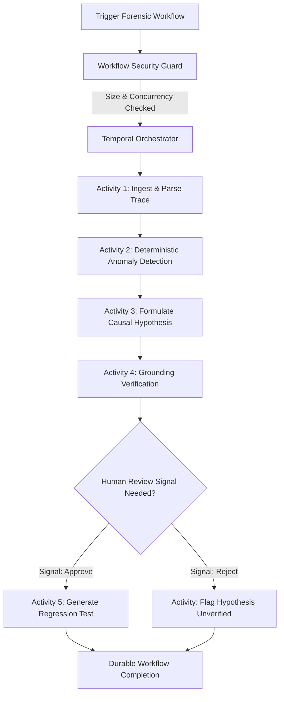

# GhostTrace — Temporal Durable Execution Integration

## 1. Overview & Forensic Role
- **Partner**: Temporal
- **Track**: Durable Execution Engine for Autonomous Agent Forensics
- **Branch**: `feat/temporal-integration`
- **Target Base**: `feat/task-02-core-product-workflow`

Complex AI agent forensic investigations involve multi-stage pipelines:
1. Large trace payload ingestion & waterfall timeline reconstruction.
2. Anomaly detection & causal hypothesis generation via LLM.
3. Grounding verification against original trace events.
4. Synthesizing executable regression tests.
5. Automated sandbox remediation and verification.

If any intermediate step fails due to API rate limits, transient network outages, or container restarts, traditional ad-hoc scripts lose state and must restart from scratch—potentially triggering duplicate LLM costs or partial state corruption.

GhostTrace integrates **Temporal** to provide:
- **Durable State Preservation**: Every forensic activity is checkpointed; workflows resume seamlessly from the point of failure without repeating completed work.
- **Human-in-the-Loop Signals**: Reviewers can signal approval or rejection of generated hypotheses before code fixes are committed.
- **Automatic Exponential Retries**: Transient HTTP/gRPC errors retry transparently with jitter.
- **Saga Compensation**: Roll back sandbox modifications if verification fails.

---

## 2. Architecture Diagram

---

## 3. Endpoints & Adapter Design

### 1. `src/lib/temporal/temporalAdapter.ts`
- `startForensicWorkflow(params)`: Initializes a durable `GhostTraceForensicWorkflow`.
- `getWorkflowExecution(workflowId, runId)`: Inspects current lifecycle state (`RUNNING`, `COMPLETED`, `FAILED`, `TIMED_OUT`, `CANCELED`).
- `sendSignal(workflowId, signalName, data)`: Delivers asynchronous human approval or rejection signals.
- Strict Zod validation: `TemporalWorkflowExecutionSchema`, `TemporalWorkflowStatusSchema`.

### 2. REST API Routes
- `POST /api/traces/temporal/execution`: Starts a durable forensic workflow, guarded by `validateWorkflowSecurity` (1 MiB body limit, rate limit, concurrency control).
- `GET /api/traces/temporal/execution/[id]`: Fetches workflow execution state.
- `POST /api/traces/temporal/execution/[id]/signal`: Sends human-in-the-loop review signal.

---

## 4. Verification & Quality Gates

### Automated Test Coverage
- **`src/__tests__/temporal.test.ts`**:
  - Address and configuration detection (`isConfigured`).
  - Missing address rejection (`CONFIG_MISSING`, 401).
  - Workflow startup with Zod schema verification.
  - Workflow state retrieval and 404 `WORKFLOW_NOT_FOUND` handling.
  - Signal dispatch verification.
  - Upstream 401 and 503 error handling with retryable classification.
- **`src/__tests__/workflowSecurity.test.ts`**: 9 security, size, and concurrency tests.

---

## 5. Live Verification Status & Transparency Notice

> [!IMPORTANT]
> **Temporal Server Status: Pending Live Verification**
> `TEMPORAL_ADDRESS` is not configured with a live Temporal cluster in this local development clone.
> When unconfigured:
> 1. GhostTrace throws explicit `TemporalError` with `CONFIG_MISSING` (401).
> 2. No synthetic executions or false workflow run IDs are faked.
> 3. All 10 adapter contract tests and 9 security tests pass deterministically using mocked endpoints and schema validation.
> When connected to a live Temporal Cloud or self-hosted cluster, durable execution will activate without any code alterations.
