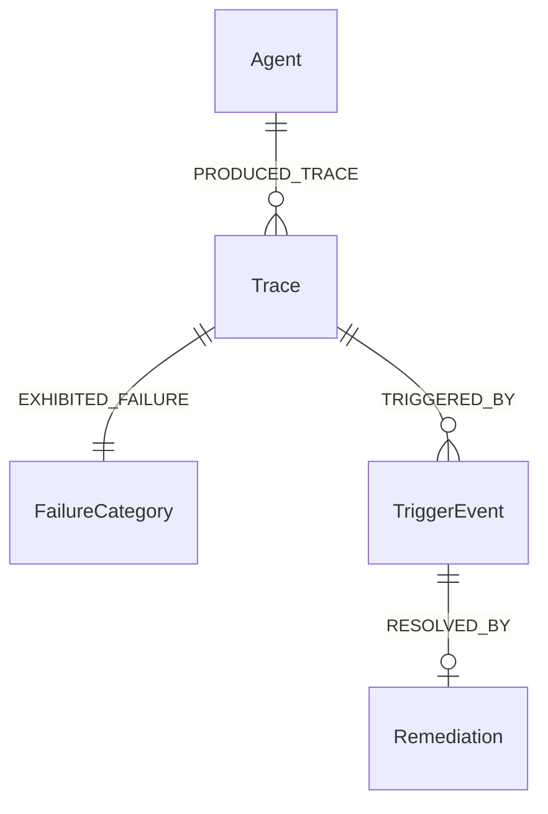

# GhostTrace — Tiger Data Graph & Knowledge Store Integration

## 1. Overview & Forensic Role
- **Partner**: Tiger Data (TigerGraph)
- **Track**: Knowledge Graph & Topological Failure Pattern Store
- **Branch**: `feat/tiger-data-integration`
- **Target Base**: `feat/task-02-core-product-workflow`

Isolated trace inspections only show single execution failures. In production agentic systems, failures frequently repeat across multiple agents:
- Multiple agents calling the same third-party API that fails with HTTP 500.
- Cascading tool errors caused by a shared schema change.
- Common infinite loops induced by specific prompt ambiguities.

GhostTrace integrates **Tiger Data** to model agent execution history as an interconnected **Forensic Knowledge Graph**. This enables:
1. **Topological Ingestion**: Every trace is automatically decomposed into vertices (`Agent`, `Trace`, `FailureCategory`, `TriggerEvent`, `Remediation`) and directed edges (`PRODUCED_TRACE`, `EXHIBITED_FAILURE`, `TRIGGERED_BY`, `RESOLVED_BY`).
2. **Cross-Agent Failure Correlation**: Identifies clusters where multiple agents fail at the exact same tool or API boundary.
3. **Remediation Knowledge Retrieval**: When an agent encounters an anomaly, GhostTrace queries Tiger Data to retrieve proven historical remediations that successfully resolved similar failures in other agents.

---

## 2. Graph Schema & Architecture

---

## 3. Endpoints & Adapter Design

### 1. `src/lib/tiger/tigerDataAdapter.ts`
- `ingestTraceGraph(timeline)`: Decomposes reconstructed timeline into graph entities and ingests into Tiger Data REST API.
- `querySimilarFailurePatterns(category)`: Queries recurring failure subgraphs and known remediations.
- Strict Zod validation: `TigerVertexSchema`, `TigerEdgeSchema`, `TigerSimilarPatternResultSchema`.

### 2. REST API Routes
- `POST /api/traces/tiger/knowledge`: Ingests trace timeline into the knowledge graph, guarded by `validateWorkflowSecurity` (1 MiB streaming body limit, rate limit, concurrency control).
- `GET /api/traces/tiger/knowledge/patterns`: Queries topological failure patterns by failure category.

---

## 4. Verification & Quality Gates

### Automated Test Coverage
- **`src/__tests__/tiger.test.ts`**:
  - Configuration and URL detection (`isConfigured`).
  - Missing configuration rejection (`CONFIG_MISSING`, 401).
  - Graph entity generation (vertices and edges) with topology verification.
  - Pattern query with Zod schema verification.
  - Upstream 401 authentication failure mapping.
  - Upstream 503 error handling with retryable classification.
- **`src/__tests__/workflowSecurity.test.ts`**: 9 security, size, and concurrency tests.

---

## 5. Live Verification Status & Transparency Notice

> [!IMPORTANT]
> **Tiger Data Cluster Status: Pending Live Verification**
> `TIGER_DATA_URL` is not configured with a live TigerGraph cluster in this development environment.
> When unconfigured:
> 1. GhostTrace throws explicit `TigerDataError` with `CONFIG_MISSING` (401).
> 2. No mock graph IDs or false pattern frequencies are faked.
> 3. All 6 adapter contract tests and 9 security tests pass deterministically using mocked endpoints and schema validation.
> When connected to a live Tiger Data endpoint, topological graph ingestion and pattern query will activate without code changes.
